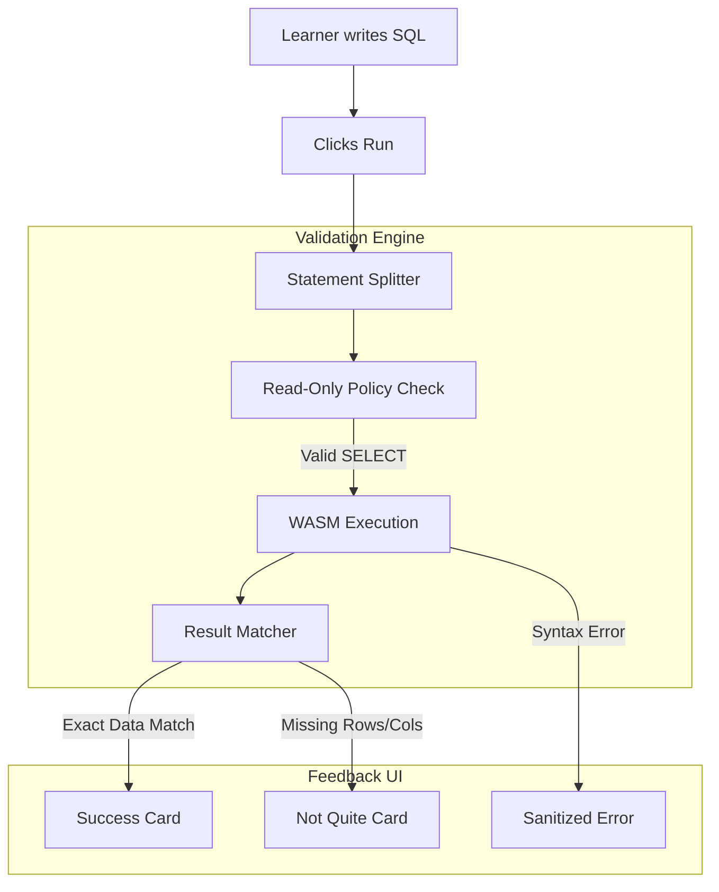

# SQL Playground: Query Challenges

This document defines the practice mode that prompts learners to write SQL, validates it against WASM datasets, and provides rich feedback without requiring one exact query string.

> [!NOTE]  
> Challenges are entirely local. They do not depend on accounts, backends, or LLMs.

## 1. Challenge Validation Flow



## 2. Challenge Data Model

Challenge content is stored strictly as TypeScript definitions in `src/components/sql-playground/challenges/`, never as ad-hoc JSX checks.

```ts
type ResultValidator = {
  kind: "result-set";
  expectedSql: Record<ChallengeEngine, string>;
  requiredColumns: string[];
  rowOrder: "exact" | "any";
}
```

> [!IMPORTANT]  
> **Matching Rules:** The validator checks the *output result set*, not the exact SQL string. A learner using `NOT EXISTS` instead of `LEFT JOIN ... IS NULL` will successfully pass the challenge.

## 3. Submission & Preconditions

When a learner submits a challenge:
1. Confirm the challenge is compatible with the active dataset/engine.
2. Verify it is a single, read-only `SELECT` or `WITH ... SELECT` statement. 
3. Execute the query via the normal WASM client.
4. Validate the resulting fields and rows against the oracle `expectedSql`.

> [!CAUTION]  
> **Read-only Policy** (`src/components/sql-playground/challenges/query-policy.ts`): Accept one statement of at most 5,000 characters that starts with `SELECT` or `WITH`. Comments, string literals, quoted identifiers and `$$` bodies are removed first, then the remaining words are checked. Reject `INSERT`, `UPDATE`, `DELETE`, `MERGE`, `INTO` (so `SELECT ... INTO` fails) and `FOR UPDATE` anywhere in the query, including inside a CTE. Reject functions that sleep, read the host, change settings or run SQL held in a string (`pg_sleep`, `pg_read_*`, `set_config`, `query_to_xml`, `dblink`, `lo_*`). A first word that is not a known write command, such as the typo `SELEC`, is reported as a syntax issue, not as a read-only violation.

## 4. Feedback States

- **Success**: Green card with a business outcome summary (e.g. "You found all 14 customers").
- **Valid SQL, Incorrect Answer**: Amber card indicating missing columns, wrong sort order, or duplicate rows (e.g. "Return exactly: id, name, country").
- **Query Error**: Sanitized error message underlining the bad token.

> [!WARNING]  
> **Never** expose raw database exception stack traces to the UI. Map them to friendly categories (e.g. "Table does not exist" or "Ambiguous column") to prevent confusing beginners with implementation jargon.

## 5. Inline Practice in Lessons

SQL lessons can embed a challenge directly in the lesson page with a `sql-practice` section (`challengeId`, `title`, `prompt`, `playgroundHref`). It is rendered by `src/components/sql/InlineSqlPractice.tsx` and reuses the same challenge definition, query policy, validator and feedback copy as Challenge Mode. It does not use the shared playground database.

- **Isolation**: queries run in `src/components/sql/sandbox/pg-sandbox.worker.ts`, a Web Worker with its own in-memory PostgreSQL (PGlite) seeded from Cycle Depot. Nothing a learner runs touches the SQL Playground session.
- **Read-only at the engine**: every query runs inside `BEGIN TRANSACTION READ ONLY` and is rolled back, so a write that slipped past the policy is still refused by PostgreSQL.
- **Timeout**: `src/components/sql/sandbox/pg-sandbox.ts` stops a query after 5 seconds by terminating the worker. A fresh worker starts on the next run. Results are capped at 500 rows.
- **Solution lock**: Reveal solution stays disabled until the learner has run a query once. The revealed text uses the challenge's hand-indented `solutionDisplay` when present.
- **Start-up**: the worker starts when the practice scrolls into view, so the rest of the lesson loads normally.
- **Progress**: a passing run is saved with the same progress record as Challenge Mode.

Do not loosen the policy, the read-only transaction or the timeout when adding a new practice.

